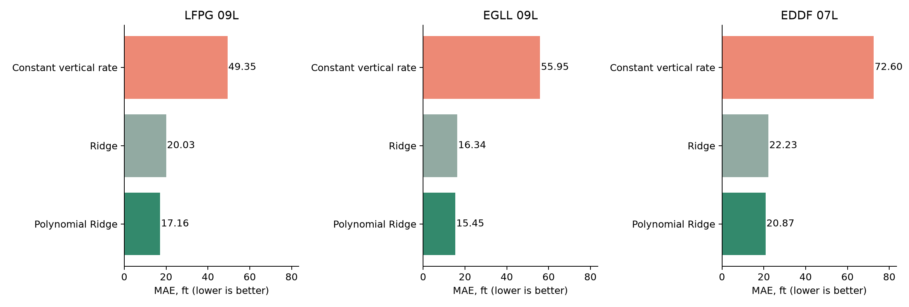
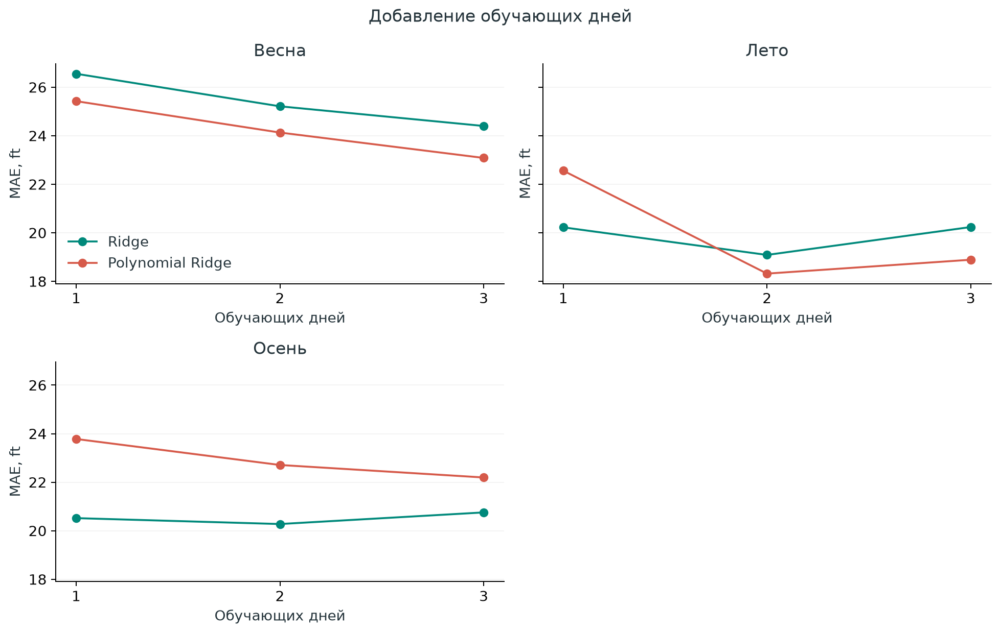

# Общий результат исследований RESEARCH

**В основных сезонных экспериментах Парижа, Хитроу и Франкфурта общая Polynomial Ridge дала наименьшую итоговую ошибку среди проверенных моделей.** Снижение ошибки относительно baseline составляет 65.2%, 72.4% и 71.3%. Это результат выбранных тестовых дней и условий, а не универсальное превосходство модели. В сохраненных предварительных пилотах лучшей была ElasticNet.

## Что прогнозируем и как читать числа

Прогнозируем наблюдаемую барометрическую высоту самолета через **30 ± 3 секунды** по предыдущей истории движения. Модели обучают поправку к baseline, который продолжает текущую вертикальную скорость. Polynomial Ridge использует квадраты и попарные взаимодействия признаков с регуляризацией Ridge.

**ft (feet) — футы, единица измерения высоты. 1 ft = 0.3048 м. MAE — средняя абсолютная ошибка прогноза высоты.** Например, 20.87 ft означает среднюю ошибку по высоте около 6.36 м. Это величина ошибки, а не высота полета самолета. Чем меньше MAE, тем точнее прогноз.

Ошибка усредняется сначала внутри каждого захода, затем между заходами. В общем результате сезоны имеют вес по числу тестовых заходов. Модель не получает преимущество только из-за большей длины отдельной траектории. Это исследование высотной динамики, не восстановление полной трехмерной траектории и не классификация ухода на второй круг.

## Объем и условия основных экспериментов

Только 2025 год. По пять погожих дней весны, лета и осени, одна полоса в каждом аэропорту. В каждом сезоне три дня обучения, один валидации и один теста. Общая модель обучается на девяти днях каждого аэропорта отдельно. Параметры выбираются по валидации; тестовые заходы одинаковы для всех моделей внутри аэропорта.

### Что называем погожим днем

В этом исследовании **погожий день** означает, что весь интервал **08:00–18:00 местного времени** проходит фильтр по архивным METAR. Условия проверяются каждые пять минут по последнему предшествующему наблюдению давностью не более 60 минут. Все точки проверки должны пройти фильтр; несколько хороших часов недостаточно. Ночь и остальные часы суток этим определением не охватываются.

| Характеристика | Условие отбора |
| --- | --- |
| Горизонтальная видимость | Не менее 10 км |
| Потолок облачности | Нижняя граница BKN/OVC или вертикальная видимость VV не ниже 3000 ft (около 914 м); также допускается подтвержденное отсутствие такого потолка |
| Ветер | Не более 15 kt (около 7.7 м/с) |
| Порывы | Не более 25 kt (около 12.9 м/с); без указанного порыва используется скорость ветра |
| Температура | От −10 до +30 °C включительно |
| Погодные явления | Нет явлений в погодном блоке METAR, отметок сдвига ветра WS и недавних явлений RE; в частности, исключаются дождь, снег, туман и гроза |
| Полнота сообщения | Видимость, ветер и температура известны; облачность описана, ее значимая нижняя граница не неизвестна; сообщение успешно разобрано |

Облачность сама по себе не исключает день: допускается пасмурная погода с достаточно высоким потолком. Учитывается наблюдаемый основной блок METAR, без прогноза TEMPO/BECMG и замечаний RMK. Это рабочее определение благоприятной погоды для эксперимента, а не эксплуатационный минимум. Полоса назначается по наблюдаемой траектории, а не только по ветру.

| Аэропорт и полоса | Дней | Заходов | Пар наблюдений | Тестовых дней | Тестовых заходов |
| --- | ---: | ---: | ---: | ---: | ---: |
| Париж, LFPG 09L | 15 | 553 | 15 931 | 3 | 55 |
| Хитроу, EGLL 09L | 15 | 5 601 | 166 508 | 3 | 1 136 |
| Франкфурт, EDDF 07L | 15 | 2 634 | 96 714 | 3 | 540 |

Сумма трех наборов: **8 788 заходов и 279 153 пары наблюдений**. Календарные даты аэропортов могут пересекаться. Общую MAE всех аэропортов не вычисляем: выборки заметно различаются по объему и составу.

## Итоговая таблица

MAE ошибки прогноза высоты в футах, меньше лучше. Все строки относятся к общим моделям на девяти обучающих днях, кроме физического baseline.

| Модель | Париж, LFPG 09L | Хитроу, EGLL 09L | Франкфурт, EDDF 07L |
| --- | ---: | ---: | ---: |
| Baseline: постоянная вертикальная скорость | 49.35 | 55.95 | 72.60 |
| Ridge | 20.03 | 16.34 | 22.23 |
| **Polynomial Ridge** | **17.16** | **15.45** | **20.87** |
| Huber | 19.57 | 16.11 | Не обучалась |
| ElasticNet | 17.85 | 16.24 | Не обучалась |

| Выигрыш Polynomial Ridge | Париж | Хитроу | Франкфурт |
| --- | ---: | ---: | ---: |
| Снижение MAE относительно baseline | 65.2% | 72.4% | 71.3% |
| Снижение MAE относительно линейной Ridge | 14.3% | 5.4% | 6.1% |
| MAE Polynomial Ridge в метрах | 5.23 | 4.71 | 6.36 |

Проценты рассчитаны по исходным CSV до округления: 100 × (1 − MAE Polynomial Ridge / MAE сравнения). Основной выигрыш дает переход от baseline к обучению; дополнительный выигрыш от полиномиальных признаков меньше.

## Проверка по сезонам

Здесь показаны общие модели, обученные на девяти днях, и их оценки на одном тестовом дне каждого сезона.

| Аэропорт | Сезон | Baseline, ft | Polynomial Ridge, ft | Лучшая проверенная модель | Ее MAE, ft |
| --- | --- | ---: | ---: | --- | ---: |
| LFPG | Весна | 44.43 | 17.93 | Polynomial Ridge | 17.93 |
| LFPG | Лето | 50.26 | 16.78 | ElasticNet | 16.29 |
| LFPG | Осень | 56.66 | 16.32 | Huber | 16.06 |
| EGLL | Весна | 59.70 | 16.67 | Polynomial Ridge | 16.67 |
| EGLL | Лето | 66.06 | 16.20 | Polynomial Ridge | 16.20 |
| EGLL | Осень | 41.45 | 13.38 | Polynomial Ridge | 13.38 |
| EDDF | Весна | 79.56 | 24.25 | Polynomial Ridge | 24.25 |
| EDDF | Лето | 67.33 | 17.81 | Polynomial Ridge | 17.81 |
| EDDF | Осень | 69.23 | 19.71 | Polynomial Ridge | 19.71 |

Polynomial Ridge лучшая в **7 из 9** сезонных сравнений. Все обученные общие модели лучше baseline во всех сезонных тестах, где они запускались. Однако Polynomial Ridge не выигрывает каждый сезон: в Париже летом лучше ElasticNet, осенью Huber.

## Предварительные пилоты и число дней

В LFPG сохранены результаты зимнего и осеннего пилотов. Их не добавляем к основному сезонному тесту и не считаем независимыми повторениями основного исследования: осенний пилот использует день, вошедший в последующий сезонный расчет.

| Предварительный пилот LFPG | Baseline, ft | Ridge, ft | Polynomial Ridge, ft | Huber, ft | ElasticNet, ft |
| --- | ---: | ---: | ---: | ---: | ---: |
| Зима, обучение на трех днях | 56.43 | 19.99 | 22.96 | 21.54 | **19.22** |
| Осень, обучение на трех днях | 56.66 | 16.44 | 17.46 | 16.41 | **16.25** |

Это прямые примеры того, что Polynomial Ridge не лучшая во всех исследованиях папки. Вывод о ее преимуществе относится к основным общим сезонным моделям трех аэропортов.

**Больше дней не гарантирует улучшения.** В кривых обучения сравниваются один, два и три дня внутри сезона, с фиксированными параметрами и тестовым днем. Одновременно меняются объем и состав данных. Во Франкфурте при обучении только на трех осенних днях Ridge лучше Polynomial Ridge: 20.75 против 22.19 ft. При общем обучении на девяти днях преимущество меняется: 21.41 против 19.71 ft на том же осеннем тесте.

Кривые обучения остальных аэропортов: [Париж](lfpg-seasonal-learning/figures/02_learning.png), [Хитроу](egll-seasonal-learning/figures/02_learning.png).

## Общий вывод и границы

**Для выбранных погожих дней переход от продолжения текущей вертикальной скорости к обучаемой поправке оправдан наблюдаемой точностью во всех трех аэропортах. Polynomial Ridge — лучший общий кандидат среди проверенных моделей при обучении на девяти днях.** Франкфурт был добавлен после результатов LFPG и EGLL как проверка этого кандидата на третьем аэропорту; его параметры отдельно выбраны по валидации EDDF.

Дополнительную сложность нельзя рекомендовать без проверки: отдельные сезоны, малые наборы и предварительные пилоты дают другие результаты. Для дальнейшего подтверждения рабочей модели полезнее новые независимые тестовые дни, чем расширение числа алгоритмов.

- На каждый сезон приходится один тестовый день. Много заходов не заменяет разнообразия дней; доверительные интервалы и статистическая значимость различий не оценивались
- Модели каждого аэропорта обучены отдельно. Перенос готовой модели между аэропортами не проверен; различие MAE не доказывает, что один аэропорт проще другого
- В EDDF сравнивались только Ridge, Polynomial Ridge и baseline. Huber и ElasticNet там не обучались
- QNH берется из предыдущего архивного METAR с условной задержкой доступности 15 минут. COR исключены в LFPG и EDDF, но включены в EGLL; реальное время публикации исправлений неизвестно
- Высота отсчитывается относительно аэродромного барометрического прокси: LFPG 392 ft, EGLL 83 ft, EDDF 364 ft. Это не радиовысота и не точная высота над порогом каждой полосы
- Геометрия является исследовательским справочником; историческая эксплуатационная применимость отдельно не подтверждена
- Вывод не распространяется автоматически на плохую погоду, другие полосы, полный трехмерный прогноз или прогнозирование ухода на второй круг

## Карта папки RESEARCH и источники чисел

- [lfpg-seasonal-learning](lfpg-seasonal-learning/README.md): основной сезонный эксперимент Парижа и сохраненные предварительные пилотные CSV
- [egll-seasonal-learning](egll-seasonal-learning/README.md): сезонный эксперимент Хитроу, четыре обученных семейства
- [eddf-seasonal-learning](eddf-seasonal-learning/README.md): проверка Ridge и Polynomial Ridge во Франкфурте
- [seasonal-comparison](seasonal-comparison/RESULTS.md): предыдущее сравнение Парижа и Хитроу, теперь входит в этот общий результат

Исходные таблицы: [LFPG final_table.csv](lfpg-seasonal-learning/reports/csv/final_table.csv), [EGLL final_table.csv](egll-seasonal-learning/reports/csv/final_table.csv), [EDDF final_table.csv](eddf-seasonal-learning/reports/csv/final_table.csv). Даты, разделение и объемы находятся в `reports/csv/selected_days.csv` каждой папки. Пилоты: [зимние метрики](lfpg-seasonal-learning/reports/csv/winter_pilot_metrics.csv), [осенняя таблица](lfpg-seasonal-learning/reports/csv/autumn_pilot_final_table.csv).

В каждой основной папке есть два выполненных ноутбука, скрипты и отдельный отчет. Для EGLL и EDDF сохраненные модели воспроизводят опубликованные MAE; высотная привязка сверена с исходными наблюдениями. Сырые данные и модели в локальных `data/` и `artifacts/` исключены из Git. Этот общий отчет собирает завершенные результаты и не означает нового обучения.
