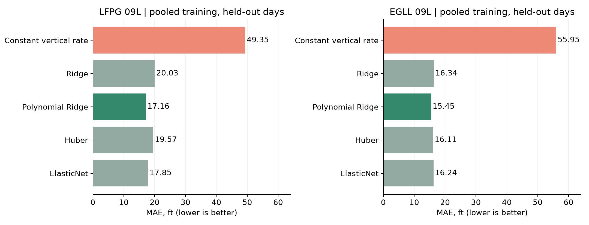
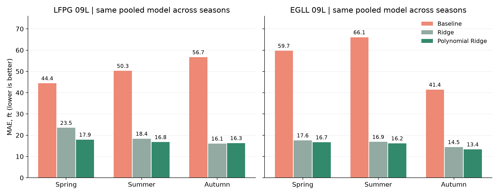

# Общий результат: сезонный прогноз высоты в Париже и Хитроу

**Polynomial Ridge дала наименьшую итоговую MAE в обоих сезонных исследованиях.** По сравнению с продолжением текущей вертикальной скорости ошибка ниже на 65.2% в Париже и на 72.4% в Хитроу. По сравнению с линейной Ridge выигрыш меньше: 14.3% и 5.4% соответственно. Это эмпирическое подтверждение на выбранных отложенных днях, а не доказательство универсального превосходства модели.

## Условия сравнения

LFPG 09L и EGLL 09L, 2025 год. Для каждого аэропорта взяты по пять погожих дней весны, лета и осени. Зима в общее сравнение не включена. Погожие условия проверялись по принятому фильтру METAR в дневном интервале 08:00–18:00 местного времени, а не круглосуточно.

В каждом сезоне три дня обучения, один день валидации и один тестовый день. Общие модели обучались на девяти днях каждого аэропорта отдельно. Все модели внутри аэропорта проверяются на одинаковых тестовых заходах. Параметры подбирались по валидации, тестовые дни не использовались для настройки параметров. Итоговый выбор лучшего семейства сделан после сравнения тестовых результатов: отдельного нового теста для подтверждения этого выбора пока нет.

Задача: прогноз наблюдаемой барометрической высоты через 30 ± 3 секунды до прокси 300 ft. Baseline продолжает текущую вертикальную скорость. Модели обучают поправку к этому прогнозу по истории движения. Polynomial Ridge добавляет квадраты и попарные взаимодействия признаков, затем применяет регуляризацию Ridge. Это умеренное усложнение, без нейросетей.

| Набор | Погожих дней | Заходов всего | Пар всего | Тестовых дней | Тестовых заходов |
| --- | ---: | ---: | ---: | ---: | ---: |
| LFPG 09L | 15 | 553 | 15 931 | 3 | 55 |
| EGLL 09L | 15 | 5 601 | 166 508 | 3 | 1 136 |

MAE сначала усредняется внутри захода, затем между заходами. Длинная траектория не получает больший вес только из-за количества точек. Итоговая MAE взвешена числом заходов, а не равным весом трех сезонов. Все значения в ft; меньше лучше.

## Итог по двум исследованиям

| Аэропорт | Baseline | Ridge | Polynomial Ridge | Снижение к baseline | Снижение к Ridge |
| --- | ---: | ---: | ---: | ---: | ---: |
| LFPG 09L | 49.35 | 20.03 | **17.16** | 65.2% | 14.3% |
| EGLL 09L | 55.95 | 16.34 | **15.45** | 72.4% | 5.4% |

Снижение ошибки = 100 × (1 − MAE модели / MAE сравнения). Расчет выполнен по исходным значениям CSV, округление применяется только для показа.

| Модель | LFPG 09L | EGLL 09L |
| --- | ---: | ---: |
| Constant vertical rate | 49.35 | 55.95 |
| Ridge | 20.03 | 16.34 |
| Polynomial Ridge | 17.16 | 15.45 |
| Huber | 19.57 | 16.11 |
| ElasticNet | 17.85 | 16.24 |

## Проверка по сезонам

Здесь оцениваются общие модели, обученные на девяти днях, а не отдельные модели каждого сезона.

| Аэропорт | Сезон | Baseline | Polynomial Ridge | Лучшая модель сезона | Ее MAE |
| --- | --- | ---: | ---: | --- | ---: |
| LFPG | Весна | 44.43 | 17.93 | Polynomial Ridge | 17.93 |
| LFPG | Лето | 50.26 | 16.78 | ElasticNet | 16.29 |
| LFPG | Осень | 56.66 | 16.32 | Huber | 16.06 |
| EGLL | Весна | 59.70 | 16.67 | Polynomial Ridge | 16.67 |
| EGLL | Лето | 66.06 | 16.20 | Polynomial Ridge | 16.20 |
| EGLL | Осень | 41.45 | 13.38 | Polynomial Ridge | 13.38 |

Все четыре обученные модели лучше baseline во всех шести сравнениях «аэропорт × сезон». Polynomial Ridge лучшая в четырех из шести: во всех трех сезонах Хитроу и весной в Париже. Летом в Париже лучше ElasticNet, осенью Huber. В Париже осенью Polynomial Ridge немного уступает даже линейной Ridge: 16.32 против 16.09 ft.

## Вывод для выбора модели

**В обоих исследованиях переход от физического baseline к обучаемой поправке оправдан наблюдаемой точностью.** Polynomial Ridge — лучший общий кандидат среди четырех проверенных семейств для этих данных и условий. Ее выигрыш над линейной Ridge составляет 2.87 ft в Париже и 0.89 ft в Хитроу.

Формулировка «в каждом случае стоит усложнять модель» слишком широкая. Здесь подтверждается польза обучения относительно baseline в обоих аэропортах, но дополнительная нелинейность полезна не в каждом сезоне. Baseline стоит сохранить как контрольный ориентир; Polynomial Ridge можно выбрать как рабочую модель следующего исследования и проверить на новых днях без повторного подбора по ним.

## Границы результата

- Один тестовый день на сезон: много заходов не заменяет разнообразия независимых дней. Статистическая значимость различий и доверительные интервалы здесь не оценивались
- Аэропорты имеют разные даты и размеры выборки. Меньшая ошибка Хитроу не доказывает, что его заходы проще. Перенос готовой модели между аэропортами не проверялся
- В EGLL использованы архивные исправленные METAR (COR) с условной задержкой доступности 15 минут. Реальное время публикации исправлений неизвестно. В LFPG COR исключались; это различие ограничивает сопоставимость
- Геометрия полос используется как исследовательский справочник; историческая эксплуатационная применимость отдельно не подтверждена
- Результат относится к краткосрочному прогнозу высоты при погожих условиях на 09L, а не ко всей трехмерной траектории, плохой погоде или прогнозированию ухода на второй круг

## Источники и воспроизведение

Исходные результаты: [LFPG](../lfpg-seasonal-learning/reports/RESULTS.md), [EGLL](../egll-seasonal-learning/reports/RESULTS.md). Числа для графиков: [LFPG final_table.csv](../lfpg-seasonal-learning/reports/csv/final_table.csv), [EGLL final_table.csv](../egll-seasonal-learning/reports/csv/final_table.csv). Даты и разделение: [LFPG selected_days.csv](../lfpg-seasonal-learning/reports/csv/selected_days.csv), [EGLL selected_days.csv](../egll-seasonal-learning/reports/csv/selected_days.csv).

Отчет и графики собираются из сохраненных CSV без нового обучения: `python research/seasonal-comparison/scripts/build_results.py`. Скрипт проверяет победителя итоговой таблицы и преимущество всех четырех моделей над baseline в каждом сезонном тесте.
